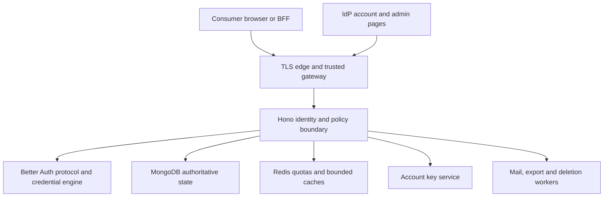

# SWYRA Auth: OAuth / OpenID Connect identity provider

Centralized identity built with Hono, Better Auth, MongoDB and Redis, with a React/Vite UI and Node.js/Lambda deployment options. Consumer applications authenticate through `/api/auth/oauth2/authorize` using Authorization Code with PKCE S256. Business authorization remains in each consumer.

## V2 program

**Status: design/documentation, not implemented by this branch.** V2 adds email OTP before account creation, chosen usernames, independent account sessions, a browser account chooser, owner dashboard/privacy, account-scoped encryption and deletion. Open consumer apps lose ordinary membership prerequisites; registered clients, consent, private memberships and scoped administration remain.

Read [the V2 document index](docs/README.md), [architecture](docs/ARCHITECTURE.md), [authentication flows](docs/AUTHENTICATION_FLOWS.md), [page inventory](docs/USER_EXPERIENCE.md), [implementation map](docs/IMPLEMENTATION_MAP.md) and [phases](docs/PHASES.md). [Specification 0008](docs/specs/0008-multi-account-identity-platform/index.md) maps requirements to tests and build slices.

Security hardening from [PR #2](https://github.com/SGOD-pro/OAuth2.1/pull/2) is merged into main at `828acc54ebe4a24fb87cf6dc2c55d79998a68895` and incorporated into this docs branch. Historical [CI at 66738b0](https://github.com/SGOD-pro/OAuth2.1/actions/runs/44947156668) and report correction `0a5727e` remain evidence for their exact commits, not a V2 implementation or deployment claim.

## Target topology



Device fingerprints are risk hints, not authentication or DDoS protection. Bloom/XOR filters are optional measured lookup tools, not uniqueness/access checks. Key destruction requires backup-safe key custody plus immediate revocation and asynchronous residual cleanup. Google-like account selection does not establish Google-equivalent security or formal conformance.

## Developer and consumer contracts

- [AGENTS.md](AGENTS.md): contributor/integration rules and version boundary.
- [docs/INTEGRATION.md](docs/INTEGRATION.md): consumer endpoints, token/session validation, SSO and logout.
- [docs/SECURITY.md](docs/SECURITY.md): threat model, algorithm choices and invariants.
- [docs/CONFIGURATION.md](docs/CONFIGURATION.md): existing settings versus proposed V2 policy.
- [docs/DEPLOYMENT.md](docs/DEPLOYMENT.md): builds, migration, key/mail readiness and recovery.
- [docs/TROUBLESHOOTING.md](docs/TROUBLESHOOTING.md): safe error/diagnostic contracts.

Never give consumer apps IdP database credentials, password/OTP forms, session tables or data keys. Confidential client secrets stay server-side. Public OAuth clients do not use a client secret; open/private access and dev callbacks are separate dimensions.

## Repository layout

| Path | Responsibility |
|---|---|
| `backend/src/routes` | Protocol and administrative routes |
| `backend/src/utils`, `middleware`, `db`, `cache` | Engine configuration, policy, state, quotas and cache consistency |
| `frontend/pages`, `components`, `lib` | Existing identity/admin UI and client transport |
| `backend/tests`, `test/` | Unit/security/e2e and consumer fixtures |
| `docs/` | Canonical design, integration, delivery and historical evidence |

Proposed V2 modules/collections/pages are explicitly marked in the implementation map; their names are not claims that files or endpoints exist.

## Local verification

Use Node.js 24 and the lockfiles for the selected source. Read backend/frontend setup before configuring isolated local MongoDB/Redis; never point disposable tests at production services.

```bash
npm --prefix backend ci
npm --prefix frontend ci
npm run security:docs-check
npm run security:integration-check
npm run test:unit
```

Full security and browser/process suites require their documented disposable dependencies. Record exact source SHA, passed/failed/skipped/blocked results and infrastructure. Docs-only validation does not establish runtime or live deployment correctness. Open-source release readiness, licensing/provenance, vulnerability disclosure and self-host instructions are explicit P9 deliverables, not inferred from repository visibility.
