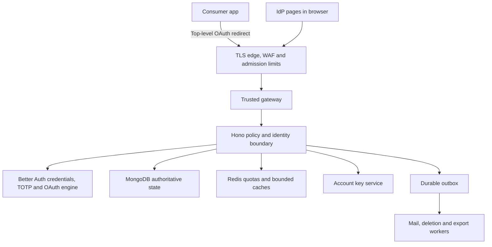

# V2 identity platform architecture

**Status:** Proposed target design, implementation pending. Updated 2026-11-22.
**Integrated repository baseline:** `main` at `828acc54ebe4a24fb87cf6dc2c55d79998a68895` (security PR #2 merged).
**Security prerequisite:** PR #2, reviewed runtime at `66738b0198b0fdb1342dec210394ac5e09041a77`; its later documentation correction is `0a5727e96a24d947a744ee8c865af35fd5c4ccb5`.
Security PR #2 is merged and its runtime is incorporated into this docs branch. Docs PR #1 remains unmerged. No V2 runtime code is added by the documentation changes. Historical main `161ad99` below identifies the pre-hardening baseline.

## 1. Product contract

SWYRA is a centralized OAuth/OIDC identity provider. A consumer starts at `/api/auth/oauth2/authorize`; identity credentials stay on the IdP. The goal is a familiar account chooser and safe account ownership, not a claim of Google-equivalent security or formal certification.

| User requirement | V2 behavior | What remains enforced |
|---|---|---|
| Create multiple accounts | One person may create separate accounts using different verified emails | One account per normalized email; separate immutable subjects and credentials |
| Verify before creation | Email OTP, then username/password, then atomic account creation | Invalid/expired/replayed OTP creates zero users, credentials or sessions |
| Choose a signed-in account | Show this browser profile's authenticated accounts; valid sessions continue without password | Eligibility, expiry, consent, private access and required assurance |
| Open consumer apps | Any eligible account may consent without an app membership prerequisite | Registered client, exact callback, PKCE, scopes, client status |
| Private apps | Explicit invitations/membership and assigned app admins | No automatic access from platform registration |
| Own account dashboard | Profile, privacy, security, sessions, grants, export and deletion | Owner-only backend checks and recent authentication |
| Admin privacy | Chosen username, or legacy email local part, plus opaque ID | Full email excluded from ordinary admin responses, logs, search and exports |
| Delete via account keys | Immediately disable authority, destroy account key paths, clean residual data asynchronously | Backup safety, metadata cleanup and consumer-owned data boundaries |
| Device security | Resettable browser identity and coarse risk signals | Fingerprints never authenticate or replace edge DDoS controls |

## 2. Document ownership and reading order

| Document | Authoritative detail |
|---|---|
| [AUTHENTICATION_FLOWS.md](AUTHENTICATION_FLOWS.md) | Enrollment, login, MFA, OAuth, recovery and internal API contracts |
| [SESSION_MODEL.md](SESSION_MODEL.md) | Account chooser, purpose-bound contexts, cookies, tab isolation and revocation |
| [USER_EXPERIENCE.md](USER_EXPERIENCE.md) | Pages, actions, loading/error states, privacy and administrative UX |
| [DATA_LIFECYCLE.md](DATA_LIFECYCLE.md) | Collections, encryption, key destruction, deletion and restores |
| [MAIL_SERVICE.md](MAIL_SERVICE.md) | Sending, templates, queues, webhook security and delivery failure |
| [ABUSE_DEFENSE.md](ABUSE_DEFENSE.md) | DDoS, risk, fingerprints, probabilistic filters and cache policy |
| [SECURITY.md](SECURITY.md) | Threat model, algorithms and security invariants |
| [IMPLEMENTATION_MAP.md](IMPLEMENTATION_MAP.md) | Existing files to change, proposed modules and data migrations |
| [PHASES.md](PHASES.md) | Dependencies, build order, tests, rollout and rollback gates |
| [INTEGRATION.md](INTEGRATION.md) | Consumer contract, stable protocol endpoints and app authorization |
| [CONFIGURATION.md](CONFIGURATION.md), [DEPLOYMENT.md](DEPLOYMENT.md), [TROUBLESHOOTING.md](TROUBLESHOOTING.md) | Typed settings, operations and diagnostics |

Specification [0008](specs/0008-multi-account-identity-platform/index.md) maps requirements to acceptance criteria. Its verification checklist is prospective, not execution evidence.

## 3. Existing code versus target

| Area | Main baseline | Reviewed security branch | V2 change |
|---|---|---|---|
| Eligibility/revocation | Earlier behavior and defects in historical review | Shared eligibility, token versions, conditional issuance and targeted family revocation | Preserve and extend to browser contexts, deletion and protected reads |
| MFA/privacy | Optional/incomplete paths | Mandatory administrative MFA and minimized projections hardened | Extend lifecycle, owner dashboard and session purposes |
| Registration | Engine signup creates identity before proof | Verification transport exists, not pre-account OTP enrollment | Registration intent/proof and one atomic finalization |
| Browser login | One ambient engine session context | Same fundamental single-context model | Independent account sessions and transaction-bound selection |
| App policy | Legacy `isPublic` and registrations | Same legacy policy retained | Separate client authentication type from open/private access |
| Data protection | Engine secret handling, no per-account erasure | Same key architecture | Protected adapter, per-account key hierarchy and deletion jobs |

Hardening is an integrated prerequisite, not V2 phase work to rebuild. Preserve historical review files as history; record superseding evidence rather than deleting findings.

## 4. Target service topology

This is one logical IdP, not a requirement to deploy many microservices. Retain Node.js/Hono/Better Auth, React/Vite, MongoDB and Redis. Initially run policy modules inside the existing backend; run asynchronous workers as separate entrypoints with narrow permissions. Lambda remains an option; a self-host profile uses the same contracts.

- The edge handles volumetric traffic and cheap rejection before database or password work.
- The gateway proves origin of requests, not user identity or app authority.
- The policy layer validates account, client, session, grant, assurance and object ownership.
- Better Auth remains the single credential and protocol engine. Add adapter/hooks, not a competing password/session implementation.
- MongoDB owns durable identity/authorization state. Use replica-set transactions for multi-record finalization/deletion boundaries.
- Redis is an accelerator and distributed budget store, never the sole record of grants or deletion.
- Workers cannot elevate roles or mint interactive authority from an outbox payload.

## 5. Independent client dimensions

| Field | Values | Meaning |
|---|---|---|
| `clientType` | `public`, `confidential` | Can this OAuth client keep a secret? |
| `accessPolicy` | `open`, `private` | Does this app require assigned users? |
| `isDev` | Boolean | Are exact registered loopback callbacks allowed? |

An open app can be confidential. A private app can be a public OAuth client. The legacy `isPublic` means user access policy, not secret custody. Super admins still register and disable clients; dynamic public client registration stays disabled. App admins cannot change trust-boundary flags.

Migration maps `isPublic=true` to `open`, false to `private`. Determine client type from actual authentication metadata, with a human-readable ambiguity report. Reject conflicting old/new fields. Preserve client IDs, secrets, callback lists, signing issuer and subject IDs. Do not silently rotate secrets or make a private app open.

Open-app `user_app_registrations` become optional connection history. Consent grants control released scopes. Private memberships and `app_admins` remain separate, authoritative assignments. Business permissions stay in the consumer app.

## 6. Account and subject policy

- Multiple accounts require distinct verified mailboxes. Accounts on one browser are never automatically linked as one person.
- Keep immutable random user IDs as `sub`. Username, email, local part and fingerprint cannot replace them. Pairwise subjects are deferred because they require a separate consumer migration.
- Initial supported email policy: ASCII mailbox addresses, trim outer whitespace, lowercase for product lookup, lowercase/validate domain; reject unsupported international forms explicitly. Explain this case-insensitive product policy. Never strip provider dots/plus tags or merge collisions silently.
- Username: 3 to 30 lowercase ASCII letters, digits and underscore, case-insensitive uniqueness, reserved names and length limits. Show availability only after a browser has a verified registration proof; final database uniqueness decides.
- New accounts choose usernames; legacy users select one during migration. Until then admin labels use email local part only. Labels can collide; always pair with an opaque account ID in administrative actions.
- Password remains a login factor. Email OTP establishes mailbox ownership at enrollment or contact change. It is not admin TOTP, device ownership or phishing-resistant MFA.

## 7. Architectural decisions that require compatibility proofs

| Decision | Direction | Evidence before implementation proceeds |
|---|---|---|
| Engine multi-session integration | Evaluate the installed Better Auth multi-session plugin first; server-side wrapper owns selection contexts | No raw session tokens exposed to browser JS; two-tab account correctness; no global-cookie subject race |
| Atomic account creation | Engine adapter writes participate in one Mongo transaction with proof consume | Failed/contended finalization leaves no usable partial identity; no public plugin signup bypass |
| Mail delivery | Provider-neutral adapter; AWS SES reference deployment; local test sink | Authenticated transport, queue expiry, suppression callbacks and bounded cost |
| Per-account key destruction | Separate account-scoped destroyable wrapping authority; AWS KMS reference profile | All old keys, replicas and backups cannot recover a destroyed account; latency/cost/quotas measured |
| Self-host key profile | Vault implementation must satisfy the same key API and restore tests | No claim of physical crypto-erasure from deleting a restorable wrapped-key row |

Stop the affected slice if a dependency cannot satisfy its contract. Record the smallest adapter change or dependency update with a new test; do not bypass engine security or invent undocumented plugin features.

## 8. Delivery boundary

This plan defines architecture, not running endpoints. Preserve hardened runtime behavior until the corresponding migration is enabled. No catch-all V2 switch may disable verification, MFA or revocation. Use slice-specific rollout controls and durable versions, with irreversible deletion fences that survive feature rollback.

Start with the integration and schema contract in [PHASES.md](PHASES.md), then deliver verified signup end to end. Abuse admission and mail budgets ship before signup is enabled, not at the end. Key architecture must be proven before advertising encryption-backed deletion.
