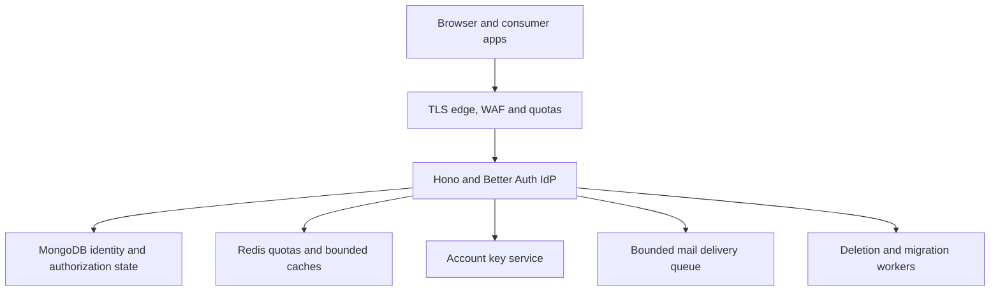

# SWYRA Auth: system architecture

**Authority:** Normative design. Updated 2026-11-19.
**Baseline inspected:** `161ad99ca4ba0de88cff1267b33807db61da306c` on `main`.
**Delivery status:** V2 is planned, not implemented by this documentation change.

Read [SECURITY.md](SECURITY.md), [INTEGRATION.md](INTEGRATION.md),
[DATA_LIFECYCLE.md](DATA_LIFECYCLE.md), [PHASES.md](PHASES.md), and
[specification 0008](specs/0008-multi-account-identity-platform/index.md).
The existing runtime remains the compatibility baseline until each migration gate passes.
This document does not certify protocol conformance or production readiness.

## 1. Current system and target

| Area | Inspected runtime | V2 target |
|---|---|---|
| Hosting | Vercel frontend/proxy, Hono on Node.js/AWS Lambda | Retain; add measured edge abuse controls |
| Storage | MongoDB identities, sessions, clients, token families; Redis limits/cache | Retain; add registration intents, browser session sets, privacy and deletion jobs |
| Login | One active Better Auth session cookie | Multiple independently authenticated accounts in one browser profile |
| Signup | Password signup; email verification defaults off | Mailbox OTP must succeed before durable identity/credential creation |
| Open apps | `isPublic=true`, automatic registration bookkeeping | Any eligible platform account can consent; no per-app membership prerequisite |
| Private apps | Explicit assigned membership | Preserve membership and invite/provisioning restrictions |
| Administration | Explicit platform and app roles; optional TOTP enrollment | Mandatory TOTP and recent MFA for every administrative authority |
| Privacy | Full email in several API/log/token paths | Minimized admin projections, scoped claims, user-owned privacy dashboard |
| Erasure | No per-account cryptographic erasure design | Per-account data keys plus durable revocation and cleanup workflow |

## 2. Service boundaries

Keep the Better Auth engine and its TOTP implementation. Add reviewed adapters and
transaction boundaries rather than a second credential system. Prove compatibility
with the installed dependency versions before selecting a multi-session plugin or
storage adapter. No bespoke TOTP or unreviewed cryptographic algorithm.

Credentials terminate only at the IdP. Consumer apps use
`/api/auth/oauth2/authorize` and existing standard token endpoints. Consumers never
receive IdP database credentials, browser session sets, TOTP seeds, or encryption keys.

## 3. Client policy has three independent dimensions

| Dimension | Target field | Values | Meaning |
|---|---|---|---|
| Client authentication | `clientType` | `public`, `confidential` | Whether a backend can keep a client secret |
| User access | `accessPolicy` | `open`, `private` | Whether explicit membership is required |
| Callback environment | `isDev` | Boolean | Whether explicitly registered loopback callbacks are allowed |

These are proposed schema fields. Today `isPublic` is an overloaded legacy field;
it must not be used as evidence that a client can or cannot retain a secret.
An open application can be confidential. A private application can be a public
OAuth client. Preserve exact callbacks, PKCE S256, state, consent, client status,
audience, scopes, and app-admin assignments for all combinations.

Migrate `isPublic=true` to `accessPolicy=open` and `false` to `private`. Determine
`clientType` using audited client authentication metadata, never that Boolean.
Ambiguous clients require explicit classification. Keep compatibility reads and
controlled writes until consumer migration passes. Reject conflicting old/new fields.
No private client becomes open implicitly. Super admins retain client registration.
External developer self-service registration remains a later separate feature.

For open apps, historical `user_app_registrations` may remain as connection history,
but must not grant or deny ordinary authentication. Consent grants and app-admin
assignments remain independent, authoritative records. Private memberships remain
checked at authorization, exchange, refresh, and online token validation.

## 4. Identity and verified account creation

An account has an immutable random `userId`, a unique verified mailbox, and a chosen
username. One person can own multiple accounts with distinct verified mailboxes.
Creating several identities for the same normalized mailbox is outside V2 scope.
No ownership or linking inference from a shared device, email prefix, or fingerprint.

Proposed username policy: 3 to 30 lowercase ASCII letters, digits, and underscore;
normalize case, reserve system names, and use a database unique index. Username is
mutable display/login metadata, never the token subject or authorization key.
Do not globally strip dots or plus tags from mailboxes. Record an explicit email
normalization policy and collision audit before migration.

Registration starts with an expiring `registration_intent`, not a `user` or `account`
record. Issue a cryptographically random mailbox code, store a server-keyed verifier,
and bind it to purpose, intent, normalized email, and browser registration transaction.
Wrong, expired, exhausted, superseded, or replayed OTPs create no identity, credentials,
session, app membership, consent, or token family. Successful verification returns
short-lived single-use proof. Finalization atomically consumes proof, reserves unique
email/username, and creates the identity and password hash. A duplicate or race creates
at most one account. Do not retain plaintext passwords in intents or the mail queue.

Email OTP proves mailbox control for enrollment. It does not replace password/TOTP
login or establish phishing-resistant MFA. Administrative invitations require verified
claiming and TOTP setup before authority becomes active. Imported `emailVerified=true`
values are not automatically accepted as evidence of mailbox ownership.

## 5. Browser session set and account chooser

A browser profile is not a physical-device identity. The IdP stores an opaque random
browser-set handle in a host-only Secure HttpOnly cookie. Server-side session-set
entries reference independent per-account session IDs, authentication times, expiry,
revocation versions, and assurance. Store token digests where supported. No account
list or bearer tokens in browser storage. Initial maximum: 10 accounts per profile.

An account entry cannot authenticate by itself. At chooser render, account selection,
authorization-code issuance, exchange, and refresh, validate the selected account's
session, expiry, status, revocation version, and required authentication strength.
Expired entries may be displayed as signed out but require credentials to continue.
Never expose remembered account lists through consumer-origin APIs or CORS.

Selection is an authenticated CSRF-protected POST bound to an unguessable server-side
OAuth transaction. Bind selected `userId` and session ID to that transaction, alongside
client ID, exact redirect URI, state, nonce, scopes, PKCE, expiry, and consent.
A browser-wide active-account preference is only a UI hint. Concurrent tabs cannot
change the subject of each other's transactions. Rotate handles at login and security
changes; prevent session fixation. Guessing a user/session ID cannot add an account.

A valid session can authorize without another password, subject to consent and
reauthentication policy. Support OIDC `prompt=select_account`, `login`, `consent`,
`none`, and `max_age` only after tested. `none` cannot silently choose among ambiguous
accounts; use OIDC errors. `login_hint` never proves identity. Include `auth_time` when
required. Retain accurate `amr`/`acr` assurance semantics, never invent achieved MFA.

## 6. Administration and account isolation

| Identity | Authority | Authentication requirement |
|---|---|---|
| `user` | Own account/privacy dashboard and consented app access | Account login; recent reauthentication for sensitive changes |
| `app-admin` | Assigned clients only | Password plus enrolled TOTP, recent MFA for admin actions |
| `super-admin` | Platform dashboard and client registration | Password plus enrolled TOTP, recent MFA for admin actions |

One account never holds both administrator roles. Separate accounts may coexist in
one browser, superseding the old single-active-IdP-account rule after migration.
A selected consumer account cannot switch the platform admin principal. Administrative
sessions have a separate audience/purpose and explicit account binding; account chooser
SSO cannot grant admin assurance. Super admins continue to receive ordinary user
claims at consumer apps, not consumer administration privileges.

Admin enrollment without TOTP allows only a restricted setup flow. Promotion, recovery,
TOTP removal, role changes, and password resets revoke prior elevated sessions.
Backup codes are one-use recovery credentials, never an invisible bypass. Prevent
self-promotion, impersonation, and plugin admin APIs from bypassing these checks.

## 7. Privacy, keys, and account deletion

The account dashboard exposes only the authenticated account's profile, chosen username,
connected apps/scopes, consent revocation, devices/sessions, privacy choices, data export,
and deletion. APIs enforce ownership server-side; selectors cannot substitute a subject.
App admins see a username or email local-part label plus an opaque subject, not a full
email. The local part is still personal data and need not be unique. Super-admin user
lists also use minimized projections. Full contact data is limited to the owner,
necessary delivery services, and explicitly consented claims or separately audited
exceptional access. Hiding columns in the UI is insufficient.

See [DATA_LIFECYCLE.md](DATA_LIFECYCLE.md) for field protection, per-account key
hierarchy, deletion states, backup handling, and why destroying a key does not revoke
a session or erase data already held by a consumer app.

## 8. Availability and abuse

Use edge traffic filtering, endpoint/IP/account/client/browser budgets, bounded queues,
mail-send budgets, request limits, database deadlines, concurrency ceilings, and
load shedding. Auth-sensitive operations fail closed when durable quota enforcement
is unavailable; a process-local fallback is not a global serverless budget.

Use a resettable first-party browser identifier and coarse, short-lived risk signals.
Fingerprint mismatch may trigger reauthentication; it never grants or revokes authority
alone. Do not require stable fingerprints across browser upgrades, VPNs, or accessibility
settings. Avoid persistent canvas/audio fingerprinting and cross-app tracking.

Bloom filters are optional performance hints after measured need. They never decide
email uniqueness, username availability, session validity, membership, revocation, or
account existence. Stale filters and false positives fall back to authoritative
storage. No externally visible filter membership oracle. See [PHASES.md](PHASES.md).
