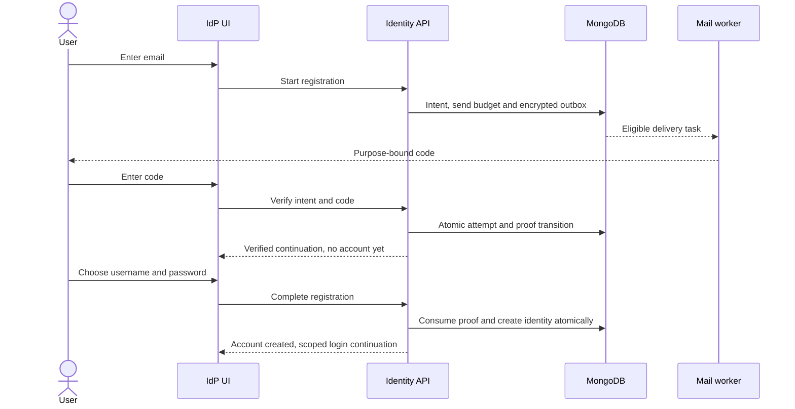
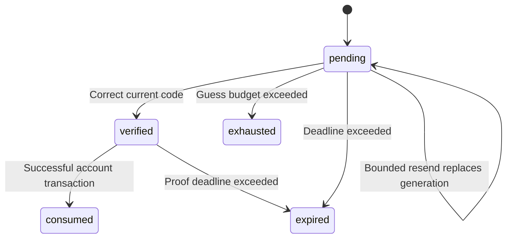
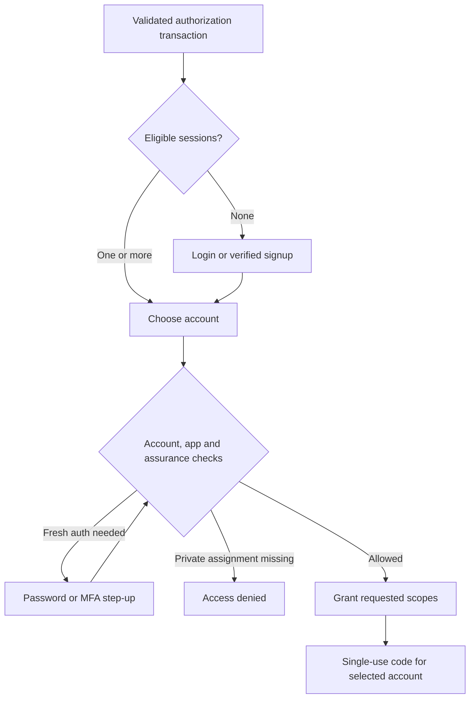

# V2 authentication workflows and API contracts

**Status:** Target contracts, not implemented. Updated 2026-11-22.
Read [architecture](ARCHITECTURE.md), [sessions](SESSION_MODEL.md), [mail](MAIL_SERVICE.md), [security](SECURITY.md) and [pages](USER_EXPERIENCE.md).
Existing `/api/auth/oauth2/*` paths remain stable. Proposed `/api/identity/*` paths are IdP UI APIs, not consumer endpoints.

## 1. Shared request contract

Identity APIs use same-origin credentials, explicit allowed Origin, CSRF protection for mutations, strict JSON schemas, primitive validation, body limits and `Cache-Control: no-store`. GET never changes account/session state. Do not reuse the broad consumer-origin CORS exceptions for these APIs. Hosted UI and API must be same-origin through the proxy for the reference deployment.

Opaque handles have at least 128 bits of randomness; credential tokens use 256 bits. Store digests where supported. URLs contain only expiring transaction identifiers, never OTPs, passwords, proofs, bearer/session tokens or email addresses. Bind every context to its browser proof and purpose. A guessed handle without matching proof is insufficient.

Internal errors use `{ error, code, requestId, retryAfterSeconds? }`; no raw database/provider messages. Client IDs are public identifiers, not identity authority. Validate callback before redirecting any OAuth error; unknown/unregistered callback errors stay on the IdP.

## 2. New verified account

1. `POST /api/identity/registration/start` accepts email, accepted terms version and optional existing OAuth transaction/invitation handle. It returns generic `202` plus a browser-bound intent handle. Registered, suppressed and new addresses receive equivalent public response shape. Never create `user`, `account`, session, consent, membership or token records here.
2. Atomically reserve send budgets and write the intent/outbox. Generate a uniform random six-digit code with a CSPRNG. Store `HMAC(verifierKey, purpose || intentId || generation || emailLookup || code)` with unambiguous encoding, expiry and attempt counters. The encrypted mail payload is the only short-lived recoverable code copy.
3. `POST .../registration/verify` accepts intent handle and code. Serialize attempts using conditional writes/transaction; expire inline, not by waiting for TTL cleanup. Five wrong attempts exhaust the generation and account/mailbox-wide budget. Constant-time verifier comparison; malformed code also consumes the applicable budget.
4. Valid verification creates a random one-use proof stored as a digest, delivered via a narrow HttpOnly registration cookie. Return only proof status, not the proof to JS. Still create no account. The proof is bound to the exact normalized mailbox and browser intent; a different email cannot be supplied at completion.
5. `POST .../registration/complete` accepts username, password and terms version. Read email from the proof. Hash the password only after cheap checks/admission. In one replica-set transaction consume valid proof, reserve unique email/username, create engine identity/credential and profile, and create an audit/outbox event. The account key reference is nullable until P6; do not claim per-account encrypted storage before that migration. Do not call an engine public signup route outside that transaction.
6. A failed username collision leaves a valid unconsumed proof so the owner can retry. A transient transaction failure never exposes a partial usable identity. Completion uses a browser-bound idempotency key: repeats return the committed outcome without recreating accounts or consuming proof twice. Lost session responses require login rather than issuing arbitrary duplicate sessions.
7. Establish an ordinary account session after commit using the engine; failure here leaves a valid account that can sign in. Enrolled admin invitation claiming continues to restricted TOTP setup before any privileged authority. Signup alone never grants private membership or admin role.

### Intent state and deadlines

Defaults: intent 30 minutes, code 5 minutes, verified proof 10 minutes or remaining intent lifetime, whichever is shorter; resend cooldown 60 seconds. Resend invalidates the previous generation and proof, cannot extend the original intent lifetime, and never resets aggregate guess/send budgets. Delivery of an old message does not make its code usable. Changed email starts a new budgeted intent.

### Closed bypasses

Existing `/api/auth/sign-up/email`, upstream social auto-provisioning, invitation acceptance, engine admin-create-user and direct engine API calls must route through proof-aware provisioning or be disabled for public identity creation. A verification callback that runs after user creation cannot meet this design. Administrative provisioning creates an invitation, not a verified password account. No `emailVerified` or `role` accepted from user input.

Existing Google sign-in may authenticate already-linked accounts according to the installed engine. New identity creation via a social provider must finish the same enrollment policy; never silently link an existing mailbox by an untrusted provider email. Provider assurance is not administrative TOTP.

## 3. Login and adding another account

| Step | Required behavior |
|---|---|
| Start | Consumer OAuth transaction, dashboard login, or explicit Add account creates a purpose-bound login intent |
| Identify | Accept email or chosen username, resolve immutable ID internally, generic failure for unknown credentials |
| Password | Engine verifies password under IP/account/global budgets; no consumer credential relay |
| Account state | Check verified/active status and token version; legacy grace applies only under explicit migration policy |
| Second factor | If account has MFA enabled, require TOTP or explicit recovery flow; admin roles always require it |
| Commit session | Rotate login/browser handles, add only the newly authenticated account session to browser set |
| Continue | Resume only the original transaction or safe internal destination; never a raw `returnTo` URL |

Login does not sign out other accounts. Reauthentication must prove the same selected subject; signing in as B cannot satisfy A's sensitive-action challenge. Error messages never reveal whether a username/email exists. Password reset request returns generic 202.

## 4. Account chooser and OAuth/OIDC

The chooser lists authenticated accounts in this browser profile, never accounts on other devices or the operating system. For the normal interactive request, show the chooser even with one account, plus Use another account. A valid session skips password entry, not policy checks. Expired remembered accounts are labeled Signed out and require login.

`POST /api/identity/accounts/select` takes `transactionId`, opaque account-entry handle and expected transaction revision. Server verifies browser-set membership, session/account status, purpose, expiry and revision, then binds the immutable subject/session to the transaction. Return a continuation, not an access token. A final commit fence rechecks the selected context before code issuance. Selection of a different account clears transaction-specific consent and stale step-up receipts.

| OIDC input | Target behavior |
|---|---|
| `prompt=select_account` | Always interactive selection; never silent ambient-cookie substitution |
| `prompt=login` | Fresh authentication of the selected subject; existing browser presence is insufficient |
| `prompt=consent` | Display consent even for previously approved scopes |
| `prompt=none` | No UI; `login_required`, `account_selection_required`, `consent_required` or `interaction_required` as appropriate |
| Multiple prompt values | Support valid combinations; reject `none` mixed with any other value |
| `max_age` | Compare selected session's real auth time; enforce fresh auth and return required `auth_time` |
| `login_hint` | Optional display hint; never account discovery or ownership evidence |
| `nonce` | Bind to this transaction and ID token; consumer must validate it |

`prompt=none` may use one unambiguous eligible account with existing consent and sufficient assurance. Two candidates require account selection. No third-party cookie dependency or hidden iframe requirement. Unsupported parameters/assurance requests fail explicitly rather than pretending they were honored.

Before exchange and refresh: validate client authentication method, exact redirect/PKCE/code bindings, user eligibility, consent version, private membership if applicable, session/family version and revoked state. Preserve durable single-winner rotation and conditional account issuance fences from hardening. Open apps skip only ordinary membership checks. ID/access tokens never contain the other browser accounts.

## 5. Email verification, two-step verification and MFA

| Mechanism | Purpose | Authority obtained |
|---|---|---|
| Enrollment email OTP | Prove mailbox control before creating identity | One-use registration proof only |
| Password | Account login knowledge factor | Ordinary session or MFA challenge |
| TOTP | Possession factor after password | Completed MFA session, subject to role/purpose |
| Email change proof | Confirm new contact after recent auth | Pending contact replacement, never account linking |
| Recovery backup code | Explicit recovery after primary login | Narrow recovery continuation; revoke old elevated sessions |
| Future passkey | Phishing-resistant authenticator after separate design | Only the assurance actually verified |

Ordinary users may enable TOTP. Both app-admin and super-admin accounts must enroll and complete TOTP before privileged access. Reuse the reviewed engine enrollment/challenge endpoints under `/api/auth/two-factor/*`; add uniform policy wrappers rather than a second TOTP implementation.

Enrollment: recent password -> setup-only context -> locally rendered QR/secret -> verify first TOTP -> atomic enable -> show one-use backup codes once -> revoke setup context -> establish MFA-complete session. Pending secrets expire and grant no authority. Never send an `otpauth` URI to an external QR service.

Challenge: password success -> challenge-only cookie -> bounded TOTP verify -> atomic accepted-step replay check -> rotate session -> record server `mfaVerifiedAt`. Never derive MFA success from a browser field. Privileged actions need MFA within 5 minutes. Consumer SSO may reuse an already completed MFA session only when freshness/purpose checks pass.

Recovery: rate-limited password plus one-use backup code -> explicit recovery session -> old sessions revoked -> re-enroll TOTP before admin actions. Lost password and all factors require a separately audited recovery procedure with no email-only admin reset. Super-admin recovery custody requires operator-run offline recovery proof, delay/notification and immutable audit; exact custody is a release-blocking runbook decision, not a hidden bypass.

## 6. Reset, contact change, invitation and deletion

- Password reset links use one-use digests, short expiry and fixed approved UI URL. GET displays a form; POST consumes proof and updates password. Revoke old sessions/families, notify owner, preserve TOTP requirement. A reset never marks an unverified mailbox verified automatically.
- Email change requires recent authentication (and admin TOTP), proof to the new mailbox, uniqueness transaction and old-mailbox notification. Old address stays active until commit. Session/lookup versions advance; revoke all pre-change sessions/families and establish only a fresh session after the new contact commit. Email is never `sub`.
- Private invitation is bound to client, intended mailbox, role ceiling, inviter and expiry. Claim only after mailbox proof and an authenticated account. Existing accounts authenticate; do not create duplicate accounts or silently promote. App-admin invitation requires platform/scoped assignment authority and TOTP activation. Super-admin provisioning remains operator-controlled.
- Deletion requires explicit account-bound recent auth, ownership confirmation, durable denial and idempotent job creation. See [DATA_LIFECYCLE.md](DATA_LIFECYCLE.md). Do not reuse normal logout for deletion.

## 7. Proposed identity API inventory

All routes below are new V2 contracts. Route schemas/OpenAPI and implemented status ship with the slice. `contextId` denotes a narrow dashboard/action context from [SESSION_MODEL.md](SESSION_MODEL.md), not an arbitrary subject supplied by the caller.

| Method and route | Input/authority | Result and ownership rule |
|---|---|---|
| POST `/api/identity/registration/start`, `/resend` | Browser registration proof, bounded intent | Generic 202; mail budget reservation |
| POST `/api/identity/registration/verify` | Intent and code | Verified continuation; no account |
| POST `/api/identity/registration/complete` | Proof cookie, username/password, idempotency | 201 committed account or safe repeat; no elevated role |
| POST `/api/identity/username/check` | Verified registration proof and candidate | Bounded availability hint; final unique index wins |
| GET `/api/identity/accounts` | Browser-set cookie, IdP origin | Minimal entry handles/labels/status, never raw tokens |
| POST `/api/identity/accounts/select` | Transaction, entry, revision, CSRF | Bind OAuth continuation to account/session |
| POST `/api/identity/contexts` | Owned entry, purpose, CSRF | Narrow account dashboard context |
| POST `/api/identity/accounts/remove` | Browser-owned entry | Remove this browser entry; no remote logout |
| GET/PATCH `/api/identity/me` | Dashboard context; allowlisted fields | Owner profile only; email/password have separate proof flows |
| GET/PATCH `/api/identity/me/privacy` | Dashboard context | Owner preferences; required security logs remain |
| GET `/api/identity/me/sessions`, `/grants` | Dashboard context | Only current subject's sessions/grants |
| POST `/api/identity/me/sessions/:id/revoke`, `/grants/:id/revoke` | Owned object, recent auth where required | Durable denial before success; unrelated accounts survive |
| POST `/api/identity/me/reauth` | Bound action challenge, engine factors | One-use action receipt, never global bypass |
| POST `/api/identity/me/export` | Recent owner auth, idempotency | 202 bounded job; GET `/export/:id` owner-only status/download |
| POST `/api/identity/me/deletion` | Recent owner auth, explicit confirmation | 202 durable deletion and narrow status receipt |
| GET `/api/identity/deletion/status` | Deletion receipt cookie | Minimal progress after account session revoked |

Do not include `/api/identity/*` in consumer discovery metadata. Consumer user data stays available through scoped UserInfo/resource APIs. Further domain data APIs require separately registered audiences and scopes, not a generic endpoint that decrypts everything.
