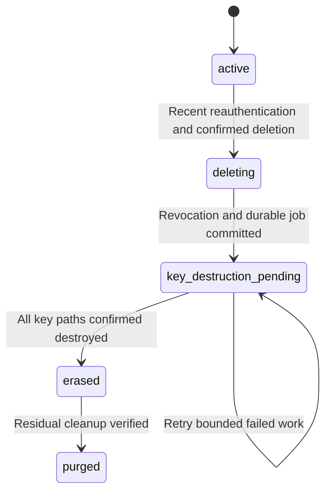

# Account data, privacy, and deletion

**Status:** V2 design, not implemented. Updated 2026-11-19.
See [architecture](ARCHITECTURE.md), [security](SECURITY.md), and
[0008](specs/0008-multi-account-identity-platform/index.md).

## 1. Data classes and access

| Data | Planned protection | Required deletion work |
|---|---|---|
| Email, profile, preferences, exports | Per-account authenticated encryption | Destroy account key paths; purge plaintext caches and export objects |
| Chosen username/local-part display label | Minimized PII; encrypt stored labels where possible | Remove lookup/display entries; apply release policy |
| Email/username exact-match indexes | Versioned keyed blind indexes plus database uniqueness | Explicitly remove entries; do not claim indexes are erased by the account data key |
| Password credentials | Engine-owned salted adaptive hash | Disable immediately, delete credential record asynchronously |
| Session/refresh/reset/OTP credentials | Digests/keyed verifiers where compatible; strict TTL | Revoke immediately, purge/expire records; no decrypt-to-auth bypass |
| TOTP seed and recovery material | Reviewed seed encryption; hashed one-use backup codes | Deny use immediately, destroy protected seeds and purge recovery records |
| Consent/private membership/admin assignment | Opaque IDs, least required policy metadata | Deny by account state/version first; asynchronously remove records |
| JWTs and consumer copies | Signed claims minimized by scope | Cannot recall offline copies; bounded expiry and consumer revocation integration |
| Audit/security logs and device signals | Pseudonymous IDs; encrypt needed PII, short retention | Redact/purge identifying fields, document required retained events |
| Shared signing keys and client secrets | Separate platform key domain | Never delete shared signing/client keys when one account is deleted |
| Backups, replicas, queues, search indexes | Inventory, encryption, expiry, restore rules | Reapply tombstones and validate every recoverable key path |

A single blanket encryption claim is insufficient. Authentication metadata must stay
available for authorization and erasure enforcement. Avoid placing email/password
or raw fingerprints in URLs, log fields, analytics, tracing, or queue identifiers.

## 2. Key hierarchy and decision gate

Each account receives a random data encryption key (DEK). Data has explicit schema
and key versions; use reviewed AEAD with account/record/purpose associated data.
Do not derive the DEK from user ID, email, username, password, or a shared master
secret. Password resets must not require decrypting password hashes.

A key service wraps/protects each DEK and permits decryption only for active accounts
and allowed service purposes. Separate database access from key administration;
log key operations without plaintext. Deny decrypt on deletion/tombstone before any
cache lookup; version-bound cache entries have bounded TTL and explicit invalidation.

**Unresolved implementation decision, blocks the encryption slice:** select a key
service whose per-account destruction cannot be undone by restoring the application
database. Candidate designs include separately destroyable per-account KMS wrapping
keys or a dedicated key vault with a proven non-restoration deletion ledger. Measure
per-account cost, latency, service quotas, availability, key deletion delay, backup
behavior, and self-hosting requirements before selecting one. A durable tombstone
alone provides denial of service access, not cryptographic destruction against an
operator who can recover old keys.

Deleting only the current wrapped DEK record is insufficient when an old backup has
the same wrapped DEK and a shared surviving wrapping key. Never destroy a shared
master key to delete one account. Key-service outage denies protected reads; no
plaintext fallback. Key rotation tracks all old versions until safely retired.

## 3. Account deletion state machine

1. Validate account ownership, CSRF, recent authentication, and explicit destructive
   confirmation. Admins also need recent TOTP. The UI states scope and consequences.
   Require safe transfer of essential admin responsibilities when necessary; no hidden
   privileged backdoor that recreates a deleted identity.
2. Atomically set `deleting`, increment account revocation version, establish a durable
   tombstone and idempotent deletion job/outbox. Return accepted status only after
   the denial state and recoverable job are durable. A database error changes nothing.
3. All login/token/session/decryption paths deny the subject immediately. In-flight
   code/refresh operations must compare the current account version at commit.
   Clear only that account's browser entries and sessions, preserve other accounts.
4. Revoke account grants, token families, reset/recovery credentials and MFA state.
   Worker cleanup is bounded, checkpointed, retryable, and idempotent. Deletion failure
   cannot set the account active again.
5. Purge key caches; request destruction for every DEK/wrapping-key version. Remain
   `key_destruction_pending` during vendor delays or uncertainty. Mark `erased` only
   with verified destruction evidence, including replicas and recoverable key copies.
6. Purge PII indexes, credential/session records, profile/search data, encrypted blobs,
   exports, pending mail and queue payloads. Preserve only documented minimal evidence.
   Mark `purged` when the inventory is reconciled. Key deletion reduces large synchronous
   cascades; it does not eliminate background cleanup.

Deleting an account is not removing it from the chooser, revoking one app, disabling
one device, or banning a user. Those operations need separate routes and UI copy.
Deletion is irreversible after key destruction; a re-registration receives a new
`userId`, no old roles, sessions, grants, keys, or recovered consumer subjects.

## 4. Backup restore and migration

The deletion/tombstone ledger must survive independently of restorable application
snapshots. Restore into quarantine, replay all tombstones, suppress queued mail, deny
obsolete sessions, and verify no deleted subject can decrypt before serving traffic.
Never restore erased key material. Retained snapshots have documented expiry and
residual metadata limits. Test restore from a snapshot taken before deletion.

Migration inventory includes `user`, `account`, `app_admins`, `user_app_registrations`,
`session`, `twoFactor`, `verification`, `oauthConsent`, `oauthAccessToken`,
`oauthRefreshToken`, `oauthAuthorizationCode`, `oauth_token_families`,
`oauth_transactions`, `auth_events`, `admin_audit`, Redis, mail queues, and exports.
Confirm actual collection names and engine writes during implementation.

Use additive versioned schemas, dry-run collision counts, dual-read compatibility,
checkpointed backfill, and write fencing. Verify every new engine write is protected
before removing plaintext. Rollback must not restore erased keys or active deleted
accounts. Never copy production PII into development fixtures.

## 5. Initial retention proposals

These values are design inputs; operators must ratify and implement them before release.
They are not current runtime promises or legal compliance claims.

| Class | Proposed maximum | Additional rule |
|---|---|---|
| Registration intents | 30 minutes | OTP expires after 5 minutes; expiry checked inline |
| Raw coarse device risk inputs | 24 hours | Avoid persistent unique fingerprint collection |
| Pseudonymous abuse counters | 30 days | Bound memory/key cardinality and document purpose |
| Session metadata | Session expiry plus 30 days | No reusable bearer secret in retained history |
| Routine identifying audit data | 30 days | Remove/encrypt account PII; separate required incident retention |
| User data exports | 24 hours | Reauthenticated owner-only retrieval; deletion cancels export |
| Application backups | 35 days | Tombstones applied on restore; key-service policy separate |
| Minimal deletion tombstones | At least longest restore/replay window | Opaque subject/version only; no email/username |

Email/username reuse requires authoritative index cleanup and a documented reservation
window. A new owner never inherits a previous account. App-held data needs an authenticated,
retryable notification/acknowledgment contract in a later slice; until delivered, tell
users that connected apps manage their own retained copies. The IdP cannot guarantee
erasure inside arbitrary third-party systems.
