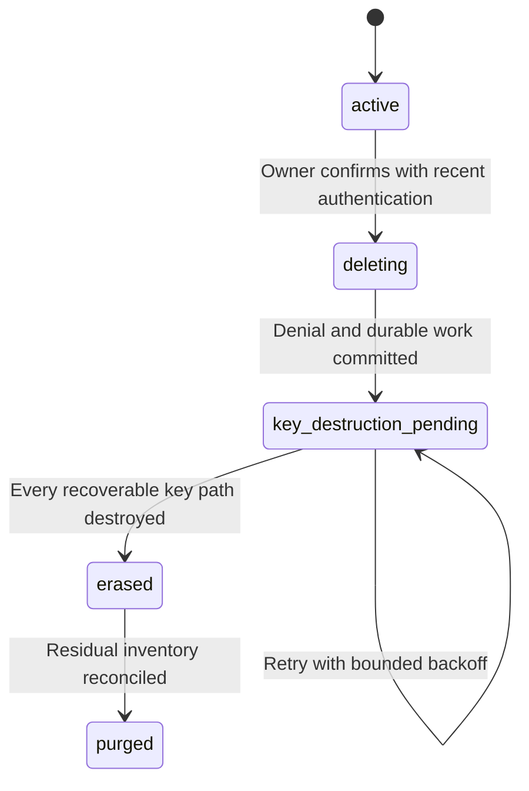

# V2 data model, encryption and account deletion

**Status:** Target design, not implemented. Updated 2026-11-22.
Related: [architecture](ARCHITECTURE.md), [sessions](SESSION_MODEL.md), [security](SECURITY.md), [delivery phases](PHASES.md).

## 1. Data ownership and schema strategy

Keep existing immutable IDs and engine collections. Add versioned records/fields through migrations, never introduce a parallel unguarded credential store. Names marked new below are proposed. The implementation spike must confirm actual plugin collection mappings, indexes and every write hook against the lockfile.

| Existing collection | V2 change | Authoritative indexes/invariants |
|---|---|---|
| `user` | Add unique normalized username/lookup, privacy version, account schema/key reference; retain account status/tokenVersion | Unique immutable ID; unique verified email lookup; unique username lookup; no ID reuse |
| `account` | Keep engine password/provider credentials, route creation through proof-aware adapter | Subject/provider uniqueness; no email lookup substitutes for subject |
| `session` | Add assurance/purpose/session version and browser linkage through supported engine extension | Unique engine token/ID; userId/expiry; inline expiry and revocation |
| `twoFactor` | Engine TOTP state under protected seed adapter | Unique subject; accepted time-step replay guard; one-use backup-code state |
| `oauthClient` | Add `clientType`, `accessPolicy`, policyVersion; retain legacy reads temporarily | Unique clientId; exact URI validation; conflicting policy writes rejected |
| `user_app_registrations` | Private membership remains; open entries become history only | Unique `(clientId,userId)`; no open entry can grant admin/private access |
| `app_admins` | Preserve explicit scoped assignments | Unique assignment; immutable user/client IDs; status/version |
| `oauthConsent` | Versioned account/client scope grants and revocation | Unique grant scope model; stale grants cannot authorize |
| `oauthAuthorizationCode` | Selected session/subject, consent/policy versions | One-use code, exact client/redirect/PKCE/transaction binding |
| `oauthAccessToken`, `oauthRefreshToken`, `oauth_token_families` | Preserve family/client/version linkage; add session/grant fences | Targeted family revocation; atomic rotation and no resurrection |
| `oauth_transactions` | Selected subject/session, browser set and revision | Unique transaction ID; status/deadline; state alone not browser proof |
| `verification` | Existing reset/challenge purposes; no unguarded signup bypass | Purpose-bound proof, attempts and inline expiry |
| `auth_events`, `admin_audit` | Pseudonymous actor IDs, minimized encrypted labels where needed | Indexed time/client/subject; no tokens/full mailbox in ordinary output |

| New logical collection | Minimum fields | Index and atomic boundary |
|---|---|---|
| `registration_intents` | ID, browserProofDigest, encryptedEmail, emailLookup, generation, verifier, attempts, expiresAt, status, termsVersion | Unique ID; TTL cleanup; conditional generation/attempt updates |
| `registration_proofs` | proofDigest, intent/email binding, expiresAt, consumedAt | Unique digest; consumed in identity-create transaction |
| `identity_profiles` | userId, encrypted attributes, privacyVersion, schemaVersion, keyRef | Unique userId; owner serializers only |
| `identity_lookup` | kind, keyVersion, keyedLookup, userId or pending owner | Unique normalized value per supported lookup version; migration collision checks |
| `browser_session_sets` | Handle digest, version, bounded entries, deadline | Unique digest; compare-and-set add/remove/rotate |
| `identity_contexts` | Handle digest, browser/session/user binding, purpose, expiry, action scope | Unique digest; no cross-purpose reuse |
| `mail_outbox` | Job/idempotency IDs, purpose, encrypted payload, generation, deadline, lease/status | Unique idempotency; lease fence; recipient budgets separate |
| `export_jobs` | Owner, request digest, encrypted object reference, deadline/status | Owner-bound retrieval; TTL object and metadata cleanup |
| `deletion_jobs` | userId, operationId, state, checkpoints, key inventory, retries | Unique deletion operation; forward-only transitions |
| `deletion_ledger` | Opaque userId, monotonic denial version, committedAt, key destruction receipts | Durable independent replay source; no plaintext PII |
| `device_observations` | user/session/browser pseudonyms, coarse signals, risk reasons, expiry | Purpose/retention-limited; never authentication authority |

Do not duplicate current `rate_limits`/origin-cache state under new names unnecessarily. Mongo TTL indexes are cleanup only; every sensitive read checks deadlines. Unknown schema/key versions fail closed with recoverable operator diagnostics, never plaintext fallback.

## 2. Field protection matrix

| Data class | Protection | Residual work after key destruction |
|---|---|---|
| Contact email, display/profile, optional preferences | AES-256-GCM under random per-account DEK | Delete ciphertext/index references, mail copies and exports |
| Username/local-part labels | Minimized PII; encrypted at rest where adapter supports, explicit owner/admin projections | Remove lookup/display rows and apply reuse policy |
| Email/username equality indexes | Domain-separated HMAC-SHA-256 blind indexes with separately managed key versions | Explicit purge; global lookup key is not erased per account |
| Password | Engine's salted adaptive password hash, not reversible encryption | Disable immediately; purge hash/credential record |
| Session/refresh/reset/proof secrets | High-entropy random credentials; digest/keyed verifier where engine supports | Revoke/expire/purge; do not decrypt credentials to bypass checks |
| TOTP seed | Reviewed engine encryption integrated with protected adapter/account key where compatible | Immediate denial, key destruction and seed/recovery cleanup |
| Backup codes | Salted/keyed one-way representation, atomically consumed | Delete hashes and never export raw codes again |
| Membership, grant, role, status and versions | Minimal opaque authorization metadata, database encryption/access control | Durable denial first; bounded asynchronous purge |
| JWTs | Signed, minimized scope claims; not encrypted or recallable | Expiry/online revocation plus consumer-local session cleanup |
| Audit/risk data | Opaque IDs, encrypted necessary PII, short retention | Redaction/purge or declared minimal event retention |
| Platform JWT signing/client secrets | Separate platform key domains | Never destroy them to delete one user |

Blind indexes leak equality and remain personal data. They are not anonymous hashes. During lookup-key rotation query both supported versions and enforce one uniqueness authority/dual-write transaction; two unique indexes on different key versions alone do not prevent cross-version duplicates. Remove obsolete indexes only after collision/backfill validation. Full email must not remain plaintext inside engine records after claiming field-level email encryption.

## 3. Encryption envelope and key API

Target envelope: `{ alg, keyRef, keyVersion, nonce, ciphertext, tag, schemaVersion }`. Use AES-256-GCM with 96-bit nonces generated through a reviewed library and full authentication tags. AAD encodes immutable user ID, collection, record ID, field purpose and schema/key version using a canonical encoding. Reject wrong-account/field substitution. Key rotation/write-volume controls must keep nonce-collision risk within the selected library's documented limits; never reuse a nonce with a key.

Each account gets an independent random 256-bit DEK, never derived from password/email/username. Password changes do not decrypt/re-encrypt the password hash. Retain versioned DEKs only while data requires them. Never log or return a plaintext DEK.

Proposed internal key interface:

| Operation | Contract |
|---|---|
| `createAccountKey(userId, operationId)` | Idempotent account-scoped key reference; unauthorized caller cannot create/attach to another account |
| `encryptField/decryptField(context, envelope)` | Check account/ledger and purpose before key use; AAD-bound data; deny on outage |
| `rotateAccountKey(userId, version)` | Versioned re-encryption with progress and rollback readers; no deleted subject rotation |
| `disableAccountKeys(userId, deletionId)` | Immediate logical decrypt denial for all versions and cache invalidation |
| `destroyAccountKeys(userId, deletionId)` | Idempotent irreversible destruction request covering versions, replicas and wrapping paths |
| `getDestructionReceipt(deletionId)` | Verifiable final/pending/failed state; scheduling is not destruction |

Only the identity data service and narrow workers access key APIs. Ordinary admins never receive broad decrypt/export authority. A compromise of running authorized code can still access permitted plaintext; envelope encryption is not protection against every active application compromise.

## 4. Key-service decision and erasure truth

**Reference cloud profile:** one independently destroyable account wrapping authority (for example an account-scoped symmetric AWS KMS key) wraps account DEK versions. The key service enforces account denial before any unwrap. All account wrapping-key versions/replicas belong to the deletion inventory. A KMS per-account profile requires a measured cost/quota review; it is not a promise of economical million-account operation.

**Self-host profile:** provide the same API through a separately secured vault with independently verifiable irreversible per-account destruction. A restorable database containing wrapped DEKs under one surviving shared KEK satisfies encryption at rest, not full per-account cryptographic erasure. That deployment must expose its actual deletion mode and cannot mark cryptographic erasure complete.

Select the backend before encryption rollout. Benchmark key create/unwrap latency, per-active-account cost, quotas, rotation, outage handling, replica deletion and backup recovery. AWS KMS key deletion has a mandatory waiting period; disable/deny immediately, report `key_destruction_pending`, and confirm actual final deletion before claiming erasure. See [AWS deletion semantics](https://docs.aws.amazon.com/kms/latest/developerguide/deleting-keys.html).

Deleting only a current DEK row is insufficient if a backup contains that DEK or its wrapped copy and the wrapping key survives. Deletion ledgers prevent authorized service use; by themselves they do not physically destroy recoverable key material against an operator with old backups. Never remove a shared platform KEK to erase one account.

## 5. Adapter and plaintext migration

1. Inventory every engine and custom writer, mail/queue payload, log, cache, export, replica and backup. Classify fields and create synthetic compatibility tests.
2. Implement a server-side protected adapter. Decrypt only for an authorized engine/service purpose and serialize only approved fields. Migrate exact email lookups to blind-index lookups without breaking engine uniqueness. Do not encrypt password hashes as a substitute for proper hashing.
3. Add envelope/key/schema versions. New writes use protection; compatible readers handle old/plaintext and new/encrypted records during a bounded migration window. Record plaintext fallback reads by count only.
4. Backfill in checkpointed batches with version predicates, not a global stop-the-world cascade. Verify decrypted values, lookup collisions, complete writer coverage and restore behavior. Enforce write fencing before plaintext removal.
5. Remove legacy plaintext fields/caches/queues and expire old backup copies under declared policy. Only then describe those fields as encrypted across recoverable storage. Migration cannot retroactively erase plaintext already present in retained snapshots.
6. Feature rollback uses compatible readers and disables optional behavior. It never reintroduces plaintext writes, revives denied subjects or reconstructs destroyed keys.

## 6. Deletion state machine and transaction

1. Verify owner/action context, CSRF and recent password; require TOTP for admin or TOTP-enabled account. Confirm responsibility transfer for the last platform recovery custodian. Produce an idempotency key and payload-bound action receipt.
2. In one durable transaction set user `deleting`, atomically advance tokenVersion, write independent deletion-ledger event and deletion job/outbox. The ledger publisher must be durable before returning accepted status; use an outbox replication barrier if the ledger is external. A failure cannot leave a successful response with no recoverable denial/work record.
3. All token, session, login and decryption boundaries deny the account immediately. In-flight issuance fences lose against deletion's state/version update. Invalidate account key caches and browser entries for this account only. Return narrow deletion-status receipt; it cannot decrypt/export/recover identity.
4. Workers revoke sessions/grants/families, suppress pending email and exports, disable all key versions and request destruction. Use bounded batches, lease fencing, retries and checkpoints; no unbounded synchronous joins/cascade required in the user request.
5. Keep `key_destruction_pending` on delay/partial failure. Obtain final destruction receipts for all applicable key versions/replicas/copies. Mark `erased` only when inventory evidence supports it; never on a scheduler's success alone.
6. Purge lookups, credential/session records, browser references, mail jobs, profile/blob/index data and identifying audit fields according to policy. Retain minimal pseudonymous denial evidence. Mark `purged` only after reconciliation. No failed job may return the account to active.

The user receives immediate access denial; physical cleanup continues. Cryptographic deletion reduces the large data-erasure workload on the request path, not the need to delete keys/indexes/credentials/metadata. Deleting A must not delete B's data, sessions or keys even on the same browser/mail domain.

## 7. Consumer and backup boundaries

IdP deletion cannot delete data already received by a consumer. UserInfo/introspection deny immediately; offline JWTs remain verifiable until expiry. Consumers must retire local sessions and own business data under their own policy.

A proposed optional deletion event uses a random event ID, per-client subject, event type/time and signed audience-bound payload. Delivery is allowlisted HTTPS through controlled egress, not arbitrary user URLs. Verify signature/audience, deduplicate, retry with bounds and redact payloads. No email or key material. This is a separate versioned contract, not an existing OIDC backchannel-logout implementation or proof of consumer erasure. Dashboard reports notification state honestly.

Deletion ledger and key destruction receipts must survive restoration independently of application snapshots. Restore into quarantine, replay ledger entries newer than the snapshot, deny obsolete subjects/sessions, suppress old mail jobs, verify key non-recoverability, then reopen traffic. Never restore erased key material or overwrite a newer denial version with an older database snapshot.

## 8. Retention and reuse defaults to ratify before public release

| Class | Proposed maximum/default | Inline rule |
|---|---|---|
| Registration intent | 30 minutes | Code 5 minutes, proof <=10 minutes; no account on expiry |
| Raw coarse risk observations | 24 hours | No persistent canvas/audio tracking |
| Session/device history | 30 days after expiry/revocation | Minimized labels; owner deletion shortens where possible |
| Export object/download | 24 hours / 5-minute authorized download | Encrypted object; owner auth on retrieval |
| Mail payload | Until deadline or confirmed send, then remove content | Metadata only for bounded delivery diagnosis |
| Security/audit events | Initial 90-day proposal | Minimal purpose-justified fields, documented operator retention |
| Backups | Initial 30-day proposal | Independently surviving deletion ledger; plaintext migration caveat |
| Deleted email/username reservation | 30-day quarantine after request; release only after required cleanup | New registration gets a new user ID; no role/grant recovery |

Ratify retention against deployment needs before enabling public deletion/export. Retain no forever email hash under the label anonymous. Tombstones can retain opaque old subjects without preserving reusable mailbox/username identifiers.

## 9. Acceptance

Prove engine writer coverage, cross-account/AAD substitution denial, nonce/rotation safety, malformed ciphertext rejection, key outage fail-closed, key-cache invalidation, finalization/deletion races, partial destruction retries, lease-stealing fences, lost worker recovery, unrelated account survival and pre-deletion snapshot restore. Cloud final destruction timing and self-host backup behavior require real key-service evidence, not mocks labeled as erasure.
