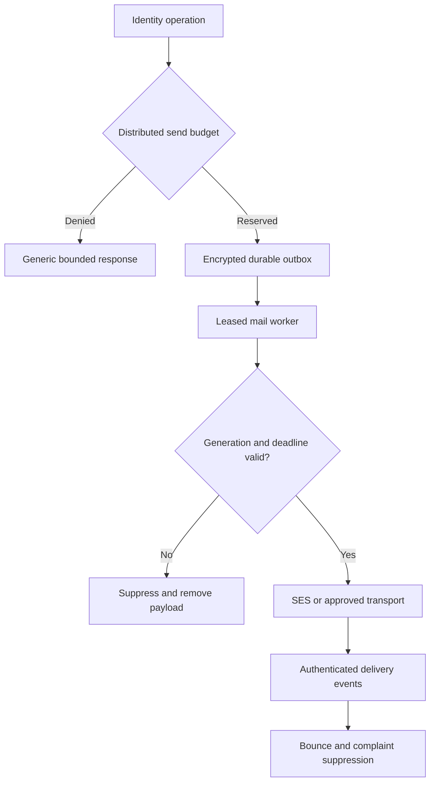

# V2 email verification and delivery service

**Status:** Target design, not implemented queue/provider. Updated 2026-11-22.
Current hardening adds `EMAIL_DELIVERY_WEBHOOK_URL` transport for engine messages. It is not the V2 proof-before-account enrollment system. Keep it compatible while moving delivery behind this service.

## 1. Boundary and deployment choice

The IdP generates intent/code/proof and decides who may receive mail. The mail service only delivers an approved purpose/template to an approved recipient. Provider acceptance, click tracking and delivery callbacks cannot mark an account verified or complete MFA.

Provider-neutral `EmailSender.send(message, idempotencyKey, deadline)` adapter. AWS SES is the reference cloud transport; SMTP-compatible provider is a self-host option with the same deadlines/budgets. Local development uses a test sink bound to loopback, never a production provider by default. Do not log codes to stdout as a development shortcut that can reach production.

## 2. Message purposes and templates

| Purpose | Required content | Security rule |
|---|---|---|
| Registration verification | Code, expiry, request context, ignore-if-not-you notice | No password/account created yet; never include code in URL |
| Contact change | New-address code, old-address notification | Old contact remains until verified commit |
| Password reset | One-use HTTPS reset link with fixed IdP host | No GET mutation, no redirect from user input |
| Admin/private invitation | Registered app name, intended role, expiring invitation | Claim requires mailbox proof/account auth; no temporary password mail |
| New session/risk notification | Coarse time/browser and safe review link | No accusation from a fingerprint change alone |
| MFA/recovery/password change | Security event and safe review link | Email cannot disable TOTP or grant admin authority |
| Export ready | Owner-authenticated dashboard link | No attachment/public data URL |
| Deletion accepted/status | Scope and irreversible/pending state | Notify before suppressing jobs; no recovery token that resurrects deleted identity |

Templates are versioned, text+HTML, escaped and accessible. Sender/subject are fixed per purpose. No user-supplied headers or raw HTML. URLs are built from typed issuer/UI configuration with an allowlist. Do not fetch arbitrary avatar/template assets on send.

## 3. Encrypted outbox and worker algorithm

Record `jobId`, `operationId`, template/purpose/version, recipient lookup key, encrypted short-lived recipient+payload, intent/generation if applicable, deadline, status, attemptCount, leaseOwner/fence/leaseExpiry and providerMessageId. Encrypt pre-account payloads using a dedicated short-lived mail/intent key domain, not a nonexistent account DEK. Keep those keys separate from OTP verifier keys.

1. Identity operation atomically reserves budgets and writes outbox with intent/action state. Duplicate browser requests use one idempotency key. A budget-store failure denies sensitive send work; no worker bypass.
2. Worker conditionally claims a lease, checks deadline, generation, suppression/deletion state and global send ceiling before decrypt/send. A stale worker cannot ack/retry after losing its fence.
3. Provider request has a 5-second timeout and a job deadline no later than code expiry. Retries: at most three attempts, exponential backoff with jitter, only while usable lifetime remains. Rate limits/known pre-acceptance transient failures may retry; permanent validation/suppression errors do not.
4. A network timeout may have occurred after provider acceptance. Prefer provider idempotency; otherwise bounded retry can deliver duplicate copies of the same current code. Do not mint a new code or refund budgets because delivery is uncertain. Exactly-once mail delivery is not promised.
5. On send acceptance remove OTP/reset payload content as soon as no longer required for bounded retries; keep minimized operational metadata. Late outbox jobs for superseded codes are discarded. Dead letters contain encrypted references and error category, never plaintext codes.

## 4. Transport and callback security

Current `EMAIL_DELIVERY_WEBHOOK_URL` must be server-configured HTTPS without loopback in production, time-bounded, and checked for non-2xx errors. V2 transport adds authenticated service requests: mTLS or a dedicated signing secret, timestamp, nonce, body digest and replay window. Headers/secrets live in typed backend configuration and deployment secrets, never frontend variables.

Callback events verify provider signature using its official SDK, event timestamp/issuer and event ID replay cache. Validate expected message IDs/purpose and cap body size. A callback cannot choose arbitrary user IDs, redirect URIs or verification state. Hard bounce/complaint triggers a durable recipient suppression record; never leak suppression/existence to anonymous callers.

Reference sender DNS: DKIM signing, SPF for authorized sending, and DMARC alignment/policy. Verify sender domain, production provider access and complaint handling before opening signup. Reference: [SES DMARC guidance](https://docs.aws.amazon.com/ses/latest/dg/send-email-authentication-dmarc.html).

## 5. Limits, outages and observability

Default mailbox budgets: cooldown 60 seconds, three sends/15 minutes, ten/day across intents and purposes where appropriate; verification guesses also have an aggregate budget. Add source IP/prefix/browser and deployment-global budgets from [ABUSE_DEFENSE.md](ABUSE_DEFENSE.md). Risk signals cannot bypass or solely trigger mail.

If queue/provider is unavailable: do not create accounts, do not call verification successful, return generic delivery-unavailable/retry state within the privacy contract. Existing sign-ins not requiring email should continue if their own security dependencies work. Isolate the queue so mail outage does not consume all web workers.

Measure queue age, intent deadline misses, send acceptance/delivery/bounce rates, per-purpose costs, throttles and dead-letter counts. Logs use random job/request IDs and purpose/error category only. An operator diagnostic cannot return recipient or token to an ordinary admin.

Test with a real local sink and controlled provider sandbox: wrong/replayed code, resend generation ordering, queue outage before/after commit, worker crash after send, timeout uncertainty, duplicate callbacks, forged callback signature, suppression, expiry before send, deletion cancellation and mailbox-flood budgets. Live mailbox delivery is separate evidence from an HTTP transport mock.
