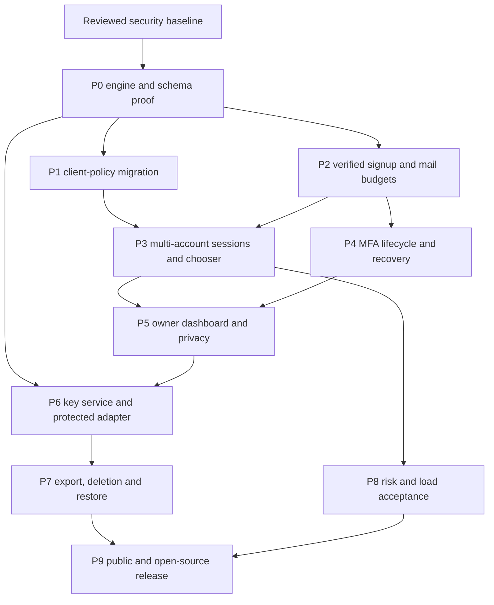

# V2 delivery phases and migration gates

**Status:** P0 isolated compatibility proof locally verified; production V2 pending. Updated 2026-11-22.
Read [architecture](ARCHITECTURE.md), [implementation map](IMPLEMENTATION_MAP.md) and [0008](specs/0008-multi-account-identity-platform/index.md).

## 1. Baseline and next task

Security hardening is reviewed at `66738b0`; [CI run 44947156668](https://github.com/SGOD-pro/OAuth2.1/actions/runs/44947156668) passed backend/frontend, 29 hardening checks, 49 CORS checks and 27 security suites. Later `0a5727e` corrects the in-process dual-instance test wording. This is historical exact-commit evidence, not a claim that V2 features exist. PR #2 is now merged into main `828acc5` and incorporated into this docs branch. Verify actual refs and CI before implementation/release.

The old phase-0 account eligibility/MFA remediation is no longer the next V2 implementation task. The reviewed security PR is integrated; this docs branch has merged main without replacing hardened runtime. Preserve that baseline for each V2 slice.

P0 engine transaction/session compatibility is locally proven in the [evidence ledger](specs/0008-multi-account-identity-platform/p0-evidence.md), including writers and limitations. After acceptance, follow with P1's additive policy split and P2's verified signup. Do not enable unsafe signup while postponing mail quotas, OTP replay defenses or uniqueness transactions.

## 2. Dependency graph

Abuse admission is a cross-cutting dependency from P0/P2, not something postponed to P8. P8 validates fleet behavior, optional risk rules and release load/cost ceilings. Scope may be subdivided into smaller PRs; dependencies and invariants remain.

## 3. Slice-by-slice build plan

| Slice | Concrete output and primary files | Required exit evidence |
|---|---|---|
| P0, compatibility/contracts | Engine writer/collection map; transaction-aware creation proof; request-local selected-session proof; config/migration version conventions. `utils/auth.ts`, `db/mongo.ts`, future engine adapter | Real engine+Mongo replica set: failed proof/create rollback creates no usable identity; real two-tab or harness subject selection independent of ambient cookie; no raw engine session-token listing to JS |
| P1, client dimensions | `clientType`, `accessPolicy`, `isDev` resolver and M1 migration; `routes/admin.ts`, `routes/auth.ts`, `utils/security.ts`, app forms | All type/access/dev combinations; zero ambiguous auto-classifications; open eligible user without membership succeeds; private unassigned user fails at authorize/exchange/refresh/online validation |
| P2a, mail and intents | Durable send budgets/outbox/provider/test sink; intent/generation/verify/proof APIs; registration/verify pages | Wrong/expired/resent/exhausted/replayed codes create zero identities/credentials/sessions; no sends on store loss; queue timeout/deadline/suppression and generic responses |
| P2b, finalization and username | Transactional unique email/username+proof consume, engine bypass closure, complete-profile page | Two workers finalizing same proof produce one account; email/username collision handling; lost response idempotency; direct plugin/social/admin-create bypass denied; real sink delivery test |
| P3, session registry and chooser | Browser set, explicit OAuth/dashboard contexts, engine wrapper, chooser/Add account/logout pages | Real browser A/B sessions and interleaved tabs, independent expiry/logout, code subject correctness, CSRF/fixation/CORS denial, OIDC prompts/max_age, revoked selected session cannot issue |
| P4, MFA lifecycle | Extend hardened mandatory admin policy to enrollment/invite/recovery and context purposes; optional user TOTP (`AC-11`, partial) | Real password/TOTP enrollment/login, setup-only API denial, backup single use, stale privileged step-up, recovery invalidation, atomic `totp_used_steps` replay guard, and plugin/cookie/context isolation locally verified; password reset, contact change, and operator lost-factor recovery custody (admin never email-only) remain open |
| P5, dashboard and privacy | Profile/security/sessions/grants/privacy pages, owner APIs, minimized claims/admin output, bounded export preparation | Account A cannot read/mutate B through IDs/context/cache; scope/privacy filtering; full email absent from admin list/search/export/log; export never includes secrets |
| P6a, key backend proof | Provider interface, reference cloud/self-host support statement, cost/latency/quotas, destruction and backup model | Real key service final-destruction test; document scheduled/pending limitations; no shared-key/backup recovery path claimed erased |
| P6b, protected adapter | Field envelopes, blind-index migration, all engine/custom writers protected, versioned reads/backfill | Cross-account/AAD failures, rotation/nonce safety, lookup uniqueness across key versions, key outage denial, complete plaintext inventory/backup caveat |
| P7, deletion and data jobs | Owner deletion, ledger/status receipt, key destroy/cleanup workers, export delivery and restore runbook | Durable denial before accepted response; multi-worker refresh/delete race; partial destruction/lost worker resumes; pre-delete snapshot restore cannot resurrect; other accounts preserved |
| P8, device risk and availability | First-party coarse observations, explainable step-up rules, edge WAF/admission/dependency budgets, load/cost measurements | Separate process quotas/failover; false-positive/mobile/VPN/accessibility trials; mail and hash-cost ceiling; no fingerprint-only decision; optional filter benchmark only if justified |
| P9, release | License/SBOM/disclosure/support policy, operator/self-host docs, migration/restore drills, independent review | Clean install plus upgrade, secret rotation evidence, all release scenarios, supported deployment profiles and explicit limitations |

Each PR updates routes, typed configuration, UI states, tests, migration and its owned docs together. Initial P0 is a bounded technical proof, not permission to start the whole platform. Document a failed engine capability honestly and revise only that adapter boundary.

## 4. Release checkpoints

| Checkpoint | Enabled behavior | Still withheld |
|---|---|---|
| Internal verified signup | P0-P2 complete; staff/test mail domains under real budgets | Public signup marketing; unsupported migration/erasure promises |
| Multi-account preview | P3-P5 complete plus current abuse controls | Cryptographic deletion until P6/P7 pass |
| Data lifecycle preview | Key backend and restore tests pass, ownership dashboard usable | Erasure labels for unsupported self-host profiles |
| Public V2 | P0-P9 acceptance complete, operator budgets and recovery custody ratified | Unimplemented passkeys, dynamic developer registration, unsupported compliance claims |

Never ship a Delete account action that pretends key destruction is implemented. During preview clearly label data features unavailable rather than rendering fake controls. Existing data APIs and consumer paths remain compatible through phased opt-in.

## 5. Migration and rollback discipline

1. Freeze target SHA, audit actual deployed config, verification provenance, client metadata and duplicate identities. No production data in development.
2. Add schemas/indexes and compatible readers before writers. Dry-run collision/ambiguity report; no automatic merge or role promotion. Test stopped/restarted batch checkpoints.
3. Enable new writes for a controlled cohort. Keep global security invariants enabled; slice rollout controls cannot bypass OTP/MFA/denial. Record schema/policy versions.
4. Observe request/error/queue/cost/risk metrics and owner reports. Roll back a cohort's optional behavior only through a compatible reader. Keep already-created accounts and monotonic revoked versions valid/denied as appropriate.
5. Key deletion, consumed proofs, revoked grants and tombstones are forward-only. Rolling back code never restores destroyed keys, unconsumes secrets or reactivates deleted accounts. Restore only in quarantine with independent ledger replay.
6. Publish new consumer expectations only when actual fixtures prove compatibility. Do not change issuer/client IDs/subjects or secret custody in an unrelated migration.

## 6. Acceptance categories

| Category | Mandatory adversarial scenarios |
|---|---|
| Enrollment | Wrong/expired/replayed/superseded codes, concurrent tries/finalization, address normalization collisions, username race, direct engine bypass, provider failure |
| Accounts | Add A/B, tab A vs B, expiry and remote revoke, chooser CSRF/fixation/entry guessing, context cache leakage, session cap |
| Protocol | Code/state/nonce/PKCE substitution, prompt combinations/max_age, scopes/consent changes, all client dimensions, replay and disabled policy |
| MFA/admin | Genuine enrollment and challenge, backup/TOTP replay, stale step-up, app/platform boundaries, promotion/recovery and plugin bypass |
| Privacy | Foreign profile/session/grant/export/deletion IDs, hidden email in JSON/search/log/export, optional claim refusal and username/local-part collision |
| Data | Key/AAD version mismatch, every protected writer, unknown key/outage, plaintext residuals and index rotation uniqueness |
| Deletion | Token issuance race, unrelated account survival, lost lease/worker, delayed key deletion, pre-deletion snapshot restore, consumer residual boundary |
| Availability | Real Redis/Mongo fallback/failover, separate workers, bounded hashing/mail/queues, forged IP/fingerprint, edge origin bypass, load shedding |
| Release | Fresh install/upgrade, secret and dependency provenance, disclosure route, operator recovery, self-host key profile limitations |

## 7. Evidence format

Record source SHA, worktree status, commands, fixture/service versions, pass/fail/blocked/skipped counts and category: source inspection, mock, in-process app instance, separate worker, real browser/network/provider/key service/restore. Tests with two Hono instances in one process must not be called separate-worker evidence.

Docs-only changes run link/contract/documentation checks and diagram validation. Runtime suites are evidence only for the exact runtime SHA where they ran. V2 checklist entries remain unchecked until the corresponding behavior and migration pass, not because the documents exist.
