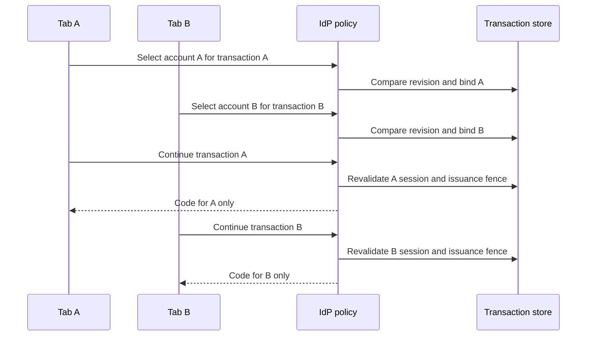

# V2 account sessions, chooser and cache consistency

**Status:** Target design. Updated 2026-11-22. P0 has an isolated [request-local engine proof](specs/0008-multi-account-identity-platform/p0-evidence.md); production multi-account sessions/chooser remain unimplemented.
Related: [flows](AUTHENTICATION_FLOWS.md), [security](SECURITY.md), [implementation map](IMPLEMENTATION_MAP.md).

## 1. Four different contexts

| Context | Owner and purpose | Cannot do |
|---|---|---|
| Browser session set | One browser profile, references independently authenticated accounts | Prove an account is active without checking its session |
| Account session | One immutable user, auth/MFA times, idle/absolute expiry and session version | Adopt another account's role or extend itself from browser presence |
| OAuth transaction | One client login attempt with selected subject/session and nonce/PKCE | Follow a browser-global account change in another tab |
| Dashboard/admin context | One tab/action purpose bound to subject, session and browser set | Act as a different selected user or carry consumer admin authority into platform APIs |

A physical device is not identifiable from a browser cookie. Private/incognito windows, cleared cookies and different browsers have separate sets. Device labels are informational. Default session-set capacity is 10 accounts. At capacity ask which entry to remove; never silently evict/revoke another account.

## 2. Session-set storage and cookies

Proposed cookie names are design names; do not deploy them until engine compatibility tests pass.

| Cookie | Attributes | Authority |
|---|---|---|
| `__Host-swyra-browser` | Secure, HttpOnly, Path=/, no Domain, SameSite=Lax | Random browser-set proof, database stores digest |
| Engine account session cookies | Existing reviewed Secure/HttpOnly engine handling | Valid engine sessions only; never return bearer tokens to JS |
| `__Host-swyra-registration` | Secure, HttpOnly, short TTL, SameSite=Lax | Registration intent/proof only |
| `__Host-swyra-mfa` | Secure, HttpOnly, challenge TTL, SameSite=Lax | Incomplete MFA continuation only |
| `__Host-swyra-deletion` | Secure, HttpOnly, narrow read-only receipt | Deletion progress, no account recovery or data access |

SameSite is defense in depth, not a CSRF substitute. Local HTTP dev uses isolated dev cookie names without the `__Host-` prefix, and no production-cookie weakening flag. The browser proof cookie may be persistent while each referenced session expires sooner. Rotating one account's credential cannot log other accounts out through accidental browser-set replacement.

Proposed `browser_session_sets` record: `id`, `handleDigest`, `version`, bounded `entries[]`, `createdAt`, `expiresAt`, `revokedAt`. Each entry has opaque public entry ID, immutable user ID, engine session ID, session version, added/last-used times and label reference. An expired remembered label has no session authority; user can remove it. Retain signed-out labels only in this first-party set and expire them under retention policy.

At authenticated add-account, rotate proof handle and update set atomically. Preserve existing entries only after validating old browser proof. Invalid proof starts an empty set, never attaches guessed subjects. Bound total cookie count/header size; choose an opaque server registry if per-account engine cookies cannot stay within budget. Never export the raw engine session token list to browser JS as a shortcut.

## 3. Engine integration decision

Better Auth documents a multi-session plugin. Its presence does not establish correct OAuth selection or token privacy. The compatibility spike must inspect the installed locked code, cookie format, list/set-active endpoints, session expiration, logout and MFA hooks.

Preferred implementation: use engine-managed account sessions behind a server adapter; the browser registry stores opaque references and uses the engine's supported server verification functions. If plugin endpoints expose session credentials, wrap/disable those responses and expose only entry handles. Do not enable an unguarded plugin route that bypasses the registry.

A request to authorize A resolves A's session from the transaction-bound entry. Do not set a shared active cookie, await another HTTP request, and assume it still means A. If the engine requires a session cookie, construct a request-local internal header from the validated server-held session, without mutating browser-wide identity or returning it to JS. This adapter must exercise the real engine and retain CSRF/account checks.

If no supported integration satisfies the tests, stop this slice and revise the adapter/dependency design. Do not build a second authentication system or rely on tab sequencing.

## 4. Transaction and tab binding

Proposed additions to existing `oauth_transactions`: `browserSetId`, `selectedUserId`, `selectedSessionId`, `sessionVersion`, `tokenVersion`, `selectionRevision`, `requiredPurpose`, `authTime`, `mfaTime`, consent/policy versions. Retain client, exact redirect, scopes, PKCE, state, nonce, created/expiry and single-use status.

For own-account pages, `POST /api/identity/contexts` creates a 15-minute renewable context tied to browser set, session, user and purpose. Return an opaque context handle to same-origin JS; keep it in memory or the tab URL fragment only, never persistent web storage. It is insufficient without the browser proof cookie. Send it in `X-Identity-Context`; validate CSRF/Origin and subject every time. Reload may require choosing the account again. Clear fragments before navigation to consumers and set Referrer-Policy=no-referrer on identity pages.

Admin contexts use separate purpose `platform-admin` or `app-admin:<clientId>` and require matching role/assignment and MFA. They cannot be created by merely selecting an ordinary chooser entry. A browser preference may choose the initial UI label but must not determine any API subject. Remove mixed-cookie/bearer ambiguity; reject conflicting principals.

## 5. Session expiry and assurance defaults

These are V2 policy defaults to implement and validate, not current engine settings.

| Authority | Idle / absolute maximum | Reauthentication |
|---|---|---|
| Ordinary session | 24 hours / 30 days | Password for sensitive actions within 5 minutes |
| Administrative session | 30 minutes / 12 hours | Mandatory MFA; privileged mutations within 5 minutes of MFA |
| MFA challenge/setup context | 5 / 10 minutes | No normal APIs until completion |
| OAuth transaction | 10 minutes absolute | Selection/auth cannot extend original deadline |
| Action receipt | 5 minutes, single use | Bound to subject, session, action and payload digest |
| Dashboard context | 15 minutes; renewable within parent session | Never refresh past parent expiry or denied account state |

Optional user TOTP also applies to sensitive action reauth when enabled. Idle renewal is throttled and uses server time, not browser timestamps. Password reset, role change, suspected compromise and deletion revoke the appropriate sessions/versions. Do not silently extend admin authority through general account SSO.

## 6. Logout and revocation semantics

| Action | Immediate effect | Preserved |
|---|---|---|
| Consumer local logout | Retire consumer app session | IdP sessions and other consumers |
| Sign out this account in this browser | Revoke chosen account's browser session and bound local transaction contexts | Other accounts and remote devices |
| Remove remembered account | Remove signed-out label; if active, require explicit logout choice first | Remote sessions and account data |
| Sign out all accounts in this browser | Revoke sessions owned by this browser set and clear it | Other devices unless explicitly requested |
| Revoke one device/session | Revoke owned session and session-bound families/contexts | Other owned sessions and unrelated accounts |
| Disconnect an app | Revoke owned consent/grant version and related token families across chosen scope | IdP sign-in and other apps |
| Revoke all account sessions | Increment monotonic account token version and retire all sessions | Other accounts |
| Delete account | Durable deleting state, version increment, all authority denied | Unrelated accounts and shared platform keys |

Targeted family revocation stays scoped to `(clientId, familyId)`. Ordinary revocation does not increment the whole user's token version. Where refresh replay has a broader compromise response, document it separately and never confuse it with ordinary logout.

## 7. Consistency and online revocation

Every online privileged/token decision reads authoritative account/session/family/grant versions or uses a demonstrably consistent fence. Cache invalidation messages accelerate cleanup; they cannot be the only guarantee. A stale positive cache may not authorize a revoked session. Metadata/labels can tolerate short staleness; authority cannot.

Existing issuance `findOneAndUpdate` token-version fences remain. Extend them to selected-session and consent/policy revocation using a transaction or equivalent durable shared fence that serializes with corresponding revocation. A final read followed by token insertion is insufficient. Minted JWTs can be computed before the fence but never returned after a losing commit. Failed cleanup cannot resurrect credentials through upsert/rollback.

Online UserInfo, introspection, management and data access reject once denial commits. Offline resource APIs can accept a valid JWT until expiry (existing access lifetime 900 seconds). A consumer-local session can outlive that unless the consumer checks status. Document this boundary; account deletion cannot remotely erase offline tokens.

## 8. Mandatory acceptance evidence

Use real browser contexts plus separate backend workers: A/B tab selections interleave deterministically; adding C preserves A/B; expiry of A preserves B; browser revocation removes correct families; admin context never inherits consumer selection; invalid proof cannot list/add accounts; `prompt=none` ambiguity errors; challenge-only session denied; revocation between selection and issuance wins; restore never revives deleted accounts.

Tests that create two Hono apps in one process are isolated application-instance tests, not proof of separate-worker cache/cookie behavior. Record test category and exact dependencies honestly.
