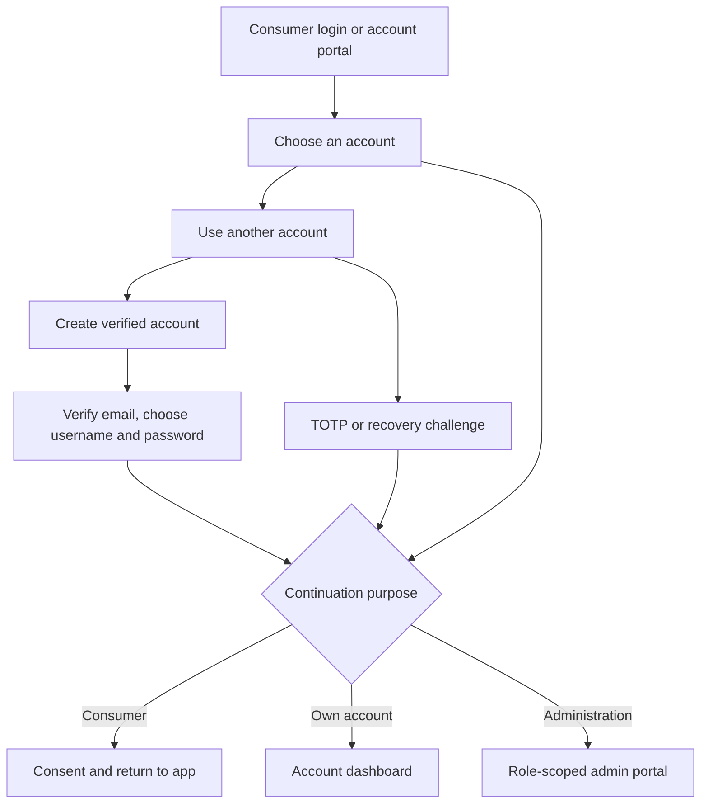

# V2 pages, account dashboard and interaction states

**Status:** Product/build contract, not implemented UI. Updated 2026-11-22.
Use the existing React/Vite router, components, themes and accessibility rules. New identity flows are full-stack work, not a styling-only task. Existing frontend restrictions on UI-only API/route edits do not describe implementation authority for a later approved V2 slice.

## 1. Navigation map

The IdP account portal is usable without OAuth query parameters. Existing `/auth` remains the legacy OAuth entry during migration; add explicit account-portal entrypoints and relax `Layout`/`useOAuthParams` only for approved standalone identity routes. Never interpret missing consumer parameters as permission to invent a callback.

## 2. Page and route inventory

All new paths are proposed stable URLs. Reuse current pages where listed; do not create a second login application.

| Page/path | Current file or proposed page | Main actions and guards |
|---|---|---|
| `/auth` | `frontend/pages/SignIn.tsx` | Existing OAuth entry; redirect validated transaction to chooser |
| `/accounts` | New `AccountChooser.tsx` | Minimal signed-in entries, Use another account, remove signed-out label |
| `/login` | Extend shared SignIn form | Email/username + password, safe server continuation, no OAuth requirement for own portal |
| `/register` | New `Register.tsx` | Email, terms, Send code; only standalone/open-app/invitation-allowed contexts |
| `/register/verify` | New `VerifyEmail.tsx` | Six-digit input, resend timer, change email; no user exists yet |
| `/register/profile` | New `CompleteRegistration.tsx` | Username, password, password confirmation, final Create account |
| `/two-factor` | Existing `TwoFactor.tsx` | Bounded TOTP/recovery challenge, no privileged data |
| `/account/mfa/setup` | New shared MFA enrollment view | Recent password, local QR, first-code confirmation and backup-code download |
| `/forgot-password`, `/reset-password` | Existing pages | Generic request, one-use reset form, no MFA removal |
| `/consent` | Existing `Consent.tsx` | Verified registered app identity, requested scopes, chosen account, allow/deny |
| `/account` | New `account/AccountOverview.tsx` | Account-specific context, own profile and security shortcuts |
| `/account/profile` | New `account/AccountProfile.tsx` | Username/display name, pending email change, owner sees full own contact |
| `/account/security` | New `account/AccountSecurity.tsx` | Password change, optional user TOTP, recovery codes, recent auth |
| `/account/sessions` | New `account/AccountSessions.tsx` | Session labels, last seen, current marker, revoke one/all |
| `/account/apps` | New `account/ConnectedApps.tsx` | Granted scopes, last authorized, revoke grant, explain consumer data |
| `/account/privacy` | New `account/PrivacySettings.tsx` | Optional claim sharing/preferences, required security data explanation |
| `/account/data` | New `account/AccountData.tsx` | Request export, deletion impact, recent auth and explicit confirmation |
| `/account/deletion` | New `DeletionStatus.tsx` | Narrow receipt-only progress after all sessions revoked |
| `/admin/login`, `/admin/two-factor` | Existing admin pages | Explicit platform-admin login and mandatory TOTP |
| `/admin`, `/admin/clients`, `/admin/logs`, `/admin/security` | Existing admin pages | Platform authority; minimized users/logs; client-policy form update |
| Consumer's app-admin pages | Consumer owned | OAuth callback and scoped API permissions, mandatory IdP MFA; no IdP password form |
| `/error`, not-found view | Shared controlled error component | Request ID, safe retry/start again; no raw provider messages |

## 3. Registration interaction rules

No combined signup submit may invoke the old create-user route before verification. Email screen -> code screen -> username/password screen is a server-backed state machine. Back button never restores an invalid proof. Refresh reconstructs only permitted state from browser-bound intent, not browser storage secrets.

Username preview shows normalized candidate and reserved/format errors. Availability is a hint; handle a final unique-index conflict by keeping the verified intent and asking for another name. Do not expose email availability. Do not store password across pages, in URL, analytics, localStorage or persistent draft state. Password managers and paste work; show/hide password control is accessible.

Wrong code: show a generic invalid/expired message and remaining attempts only to the intent owner. Exhausted/expired: disable verification and offer budgeted restart. Queued delivery: show Sent/Delivery pending honestly; no fake success email notification. The API's generic acceptance is not delivery evidence. Explain that a new account exists only after final completion.

Private-app login page offers Sign in and invitation help. It never promises that creating an unrelated platform account grants private access. A user may navigate to the standalone account portal, but that must not continue the private app without assigned membership.

## 4. Chooser and consent

Each entry has chosen username/display name, optional locally safe avatar, status and this-browser label. The first-party chooser may show a masked contact label already associated with a valid browser-set entry to disambiguate; it never accepts an arbitrary email lookup. Never show another person's full email on a shared-screen chooser by default. Signed-out entries clearly require login; an active account card cannot imply current admin authority.

Always show the registered app name and verified host from the server, not query-string branding. Unverified user-supplied logos are sanitized/self-hosted or omitted. Clicking A sends only A's opaque entry and transaction revision. Disable duplicate submits; stale revision returns to chooser without substituting another account. Use another account adds a session while preserving existing entries.

Consent names the selected account, requested scopes and data fields, the client host, privacy policy link if configured, and revoke path. Deny returns a controlled OAuth error. Switching account clears pending consent/step-up and rechecks private membership. Never silently grant a new scope because the account signed in before.

## 5. Own-account dashboard details

| Panel | Data shown | Mutation and confirmation |
|---|---|---|
| Overview | Username, own verified contact, security state | Switch account creates a new context; other tabs remain bound |
| Profile | Chosen username, display name, optional avatar | Field allowlist; contact change uses fresh proof |
| Security | Password last changed, TOTP status, backup-code availability | Recent auth; never return password hash/TOTP seed after enrollment |
| Sessions | User-supplied label, coarse browser/OS, last seen, expiry, current session | Revoke exact owned session; Sign out all has account-specific scope |
| Connected apps | Registered name, granted scopes, grant time | Disconnect revokes grant/tokens; does not delete consumer business records |
| Privacy | Claim sharing and optional activity/device preferences | Required audit/abuse processing explained; no impossible disable-all-security promise |
| Data | Export status/download expiry, deletion impact | Reauth and exact account confirmation, durable job states |

Do not describe a fingerprint as a reliable device identifier. Unknown location/browser is an honest display state. No fabricated geo accuracy, threat scores or charts without data. Session labels are editable metadata, never evidence of ownership.

Privacy controls: `shareEmail`, `shareProfile`, `allowOptionalActivityHistory`, `allowOptionalDeviceSignals` with versioned defaults: sharing email/profile is allowed only when a corresponding scope is explicitly consented; optional activity history and optional device signals default off. Required minimal fraud/session signals remain separately explained. Scope approval and field sharing are both required for optional claims; mandatory protocol subject cannot be hidden. If a consumer requires refused email access, explain the refusal rather than granting secretly. The owner's contact remains available for security mail regardless of consumer-sharing preference.

Export includes only owned data, grants and documented security history, excluding passwords, recovery secrets, other accounts, platform keys and private operator data. Download requires the owner session and short expiry; no public signed URL in email.

Deletion confirmation displays the chosen username, app connections that will lose access, irreversible key-destruction boundary and expected asynchronous progress. Do not claim instant erasure while keys are pending deletion. The last super admin must transfer platform recovery custody or provision another verified MFA-enabled super admin through authorized operations before self-deletion. Do not silently prevent deletion forever or let an app admin delete another user as owner.

## 6. Administrative page changes

Register/Edit app exposes three separate controls: Client authentication type, User access policy, and Development callbacks. Explain each in plain language and protect edits by super-admin authority. Show no public-app user allowlist requirement. Preserve private invitations/members and app-admin assignment UI. See the [P1c administrative interface specification](specs/0008-multi-account-identity-platform/0008-p1-client-policy-migration.md#administrative-interface-specification-slice-p1c) for exact control behaviors, creation defaults, ambiguous record resolution, credential transition alerts, and browser acceptance checks BAC-P1C-01 through BAC-P1C-06.

User lists, logs, exports and search results use `{ accountId, username/displayLabel, status, role }`. Do not ship full email then hide it in JSX. Admin search uses username/opaque ID; raw email lookup for delivery is backend-only and separately authorized. Labels from the email local part are not unique; administrative actions target IDs. Admins receive no default decrypt/export-as-user operation.

MFA pages cannot render dashboard data during enrollment/challenge. Stale admin MFA sends the user to step-up and resumes only the bound operation, with confirmation before destructive actions. Existing consumer-super-admin isolation remains.

## 7. Universal states and accessibility

Every page defines initial/loading/submitting/success/error/expired/offline/denied states. Idempotent mutations prevent double-click duplication; buttons show actual pending work. Never retry OTP, code exchange, delete or recovery automatically after an unknown outcome. Poll only bounded job-status endpoints with backoff.

Keyboard navigation, meaningful labels, focus management, screen-reader error summaries, paste/autofill support, visible focus, at least 44px interactive targets, reduced motion and accessible CAPTCHA fallback are required. Use local fonts/assets; no third-party analytics on identity pages. Follow existing theme tokens and component rules rather than restyling the whole app during auth implementation.

Acceptance uses real browser tests for signup, resend, expired proof, add-account, A/B tabs, independent logout, MFA challenge/step-up, private denial, scope refusal, cross-owner dashboard/API denial, export and deletion. Visual screenshots alone do not prove security.
